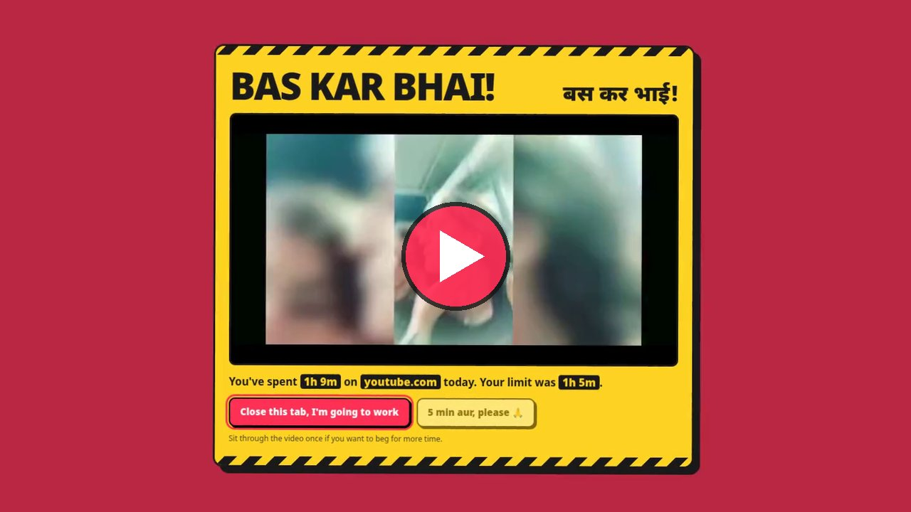
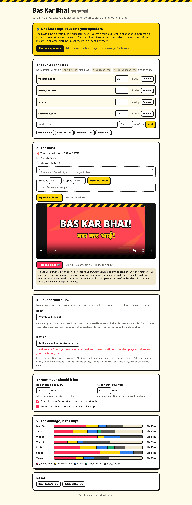

# Bas Kar Bhai 🚨

*बस कर भाई — "enough, bro."*

A screen-time tracker with consequences. Set a daily limit for YouTube, Instagram, X, whatever eats your day. When you blow past it, **a video slams onto your screen and blasts at full volume**. Everyone around you hears it, you get embarrassed, and you close the tab. That's the whole idea.

It's a Chrome extension (works in Chrome, Brave, Edge and other Chromium browsers). A phone version is on the roadmap.

## Demo

<p align="center">
  <a href="docs/demo.mp4">
    
  </a>
</p>

<p align="center"><sub>15 seconds, with sound. Click to watch.</sub></p>

## Screenshot

<p align="center">
  
</p>

<p align="center"><sub>The settings page. The usage chart shows sample data.</sub></p>

## Features

- **Tracks time per website**, only while the tab is actually in front of you (focused window, not idle). A video playing with sound still counts, even if you haven't touched the keyboard.
- **Daily limits per site.** A limit on `youtube.com` also covers `m.youtube.com`, `music.youtube.com`, etc.
- **The blast:** a full-screen overlay with a loud siren/air-horn video. It pauses the page's own media, mounts inside fullscreen players, and keeps coming back every few minutes while you stay.
- **Begging is allowed, after the shame:** "5 min aur" only unlocks once the video has played through once. The video itself loops (between your start/stop times, if you set them) until you leave.
- **Use any YouTube video:** paste a link (youtu.be, watch, shorts, with or without `?t=`), optionally pick start/stop times. It plays at volume 100 inside the overlay.
- **Or bring your own file:** upload any video or audio clip (up to 60 MB).
- **Badge** on the toolbar icon shows minutes left on the current site (`!!` once you're over).
- **Popup** with today's usage, **settings page** with a 7-day history.
- **Private:** everything stays in your browser. No servers, no accounts, no analytics.

## Install

It isn't on the Chrome Web Store yet, so install it in developer mode:

1. Download the code: `git clone https://github.com/rishi-chauhan/bas-kar-bhai.git`, or use **Code → Download ZIP** on GitHub and unzip it.
2. Open `chrome://extensions` (or `brave://extensions`, `edge://extensions`).
3. Turn on **Developer mode** (top right).
4. Click **Load unpacked** and pick the `extension/` folder inside the repo.
5. The settings page opens. Click **Find my speakers** (one-time microphone permission, see below), set your limits, turn the volume up, and hit **Test the blast**.

To update later, `git pull` (or download the ZIP again) and click the reload icon on the extension's card in `chrome://extensions`.

## Privacy and permissions

Nothing you do is sent anywhere. There are no servers, accounts, analytics or trackers. Your usage history and settings live in `chrome.storage.local`, and your uploaded clip lives in the extension's IndexedDB. Both are deleted when you remove the extension.

The only network requests the extension makes are to YouTube, and only if you choose a YouTube video for the blast (to show its title and to play it).

Why it asks for what it asks for:

| Permission | Why |
| --- | --- |
| Read your browsing history / access all sites (`tabs`, `<all_urls>`) | To see which site is in front of you, and to show the overlay on whatever site you're over the limit on. |
| `idle` | To stop counting when you walk away (unless a video is playing). |
| `storage`, `unlimitedStorage` | Settings, usage history, and your uploaded clip. |
| `alarms` | A 30-second tick so time is counted even with no tab events. |
| `scripting` | Injects the overlay into the offending tab. |
| `offscreen` | A hidden page that plays the sound when a site blocks autoplay, or to reach the built-in speakers. |
| `declarativeNetRequestWithHostAccess` | Adds a `Referer` header to the extension's own YouTube embeds so they play (details below). |
| Microphone (optional, asked once) | Chrome only reveals your speaker names after mic access. The mic is released immediately and nothing is recorded. |

## How loud is "full volume"?

No browser extension can change your **system** volume (there's no API for it, and extensions can't fake the volume keys). So Bas Kar Bhai squeezes out every bit of loudness it can within that limit:

- **Louder than 100%.** The bundled siren and uploaded files go through a Web Audio boost (+12 dB by default, up to +18 dB) and a limiter. Quiet phone-recorded clips come out far louder at the same system volume, without crackling.
- **Muted tab? Not anymore.** If you muted the site in the browser, it gets unmuted before the blast, and again if you try to mute it during the blast.
- **Always on the speakers.** The blast plays on your built-in speakers, even while Bluetooth headphones are connected. Chrome only shows an extension your output devices after you allow microphone access, so the settings page asks once ("Find my speakers"). The mic is released immediately and nothing is recorded. The speakers are picked by name (e.g. "MacBook Pro Speakers", "Speakers (Realtek…)", "… Analog Stereo"), skipping headphones, HDMI monitors and virtual devices. If the guess is wrong you can pick the device yourself; if the mic is blocked or no speakers are found, it plays on the current output. Wired headphones usually share a device with the speakers, so they can't be skipped.
- **Sound always plays.** If the site blocks autoplay with sound, the picture plays muted in the overlay and the sound comes from a hidden extension page instead, which isn't subject to that rule.

YouTube videos play at volume 100 but can't be boosted or sent to a specific device, because their audio lives inside YouTube's own player. For maximum damage, upload your clip as a file. If YouTube can't play at all (offline, video deleted, embedding disabled), the bundled siren plays instead.

## Project layout

```
extension/
  manifest.json        MV3 manifest
  background.js        service worker: time tracking, limits, triggering the blast
  content/inject.js    injected into the offending tab; mounts the overlay iframe
  overlay/             the full-screen "BAS KAR BHAI!" overlay (extension page)
  offscreen/           hidden page that plays audio when the site blocks autoplay
  popup/               toolbar popup
  options/             settings page
  lib/                 shared helpers, loudness boost, YouTube player bridge, IndexedDB for custom videos, theme
  media/default.mp4    bundled blast video
  icons/
scripts/make_assets.py regenerates the default video and icons from scratch
docs/                  README images and demo video
```

There's no build step and no dependencies: the `extension/` folder is loaded as-is.

### How tracking works

The worker remembers which site is in front of you and since when (`chrome.storage.session`). On every tab switch, URL change, window focus change, idle change, and on a 30-second alarm, it credits the elapsed time to that site, then checks its limit. Single chunks are capped at 2 minutes, so a laptop that slept on YouTube doesn't come back with 8 hours of "usage".

Data lives in `chrome.storage.local` (settings and per-day usage, kept for 30 days). Custom videos live in the extension's IndexedDB.

### Why YouTube needs `declarativeNetRequest`

YouTube refuses to play embeds that arrive without a `Referer` header ("Error 153"), and pages inside an extension don't send one. The worker installs one rule that sets `Referer: https://<extension-id>.chromiumapp.org/`, only on the extension's own embed requests (they carry a `bkb=1` marker). YouTube embeds on other websites are untouched. The player is controlled through YouTube's iframe `postMessage` protocol, since MV3 extensions can't load the remote IFrame API script.

### Regenerating assets

The default video and icons are synthesized entirely in code (no third-party media):

```bash
python3 scripts/make_assets.py
```

Needs Python 3 + Pillow, `ffmpeg` with libx264/aac, and the Noto Sans + Noto Sans Devanagari fonts.

## Roadmap

- [ ] Chrome Web Store listing
- [ ] Android app (UsageStats for tracking, overlay + max media volume for the blast)
- [ ] Firefox build
- [ ] Schedules (limits only on weekdays / work hours)
- [ ] Weekly shame report

## Contributing

Bug reports, ideas and pull requests are welcome. Please [open an issue](https://github.com/rishi-chauhan/bas-kar-bhai/issues) first for anything bigger than a small fix, so we can agree on the approach.

To work on it: load `extension/` unpacked (see [Install](#install)), make your change, then hit the reload icon on the extension's card. Logs from the service worker show up under **Inspect views: service worker** on that card; the popup, settings page and overlay each have their own DevTools.

Please keep it dependency-free and private: no build tools, no remote code, no network calls beyond YouTube.

## License

[MIT](LICENSE)
